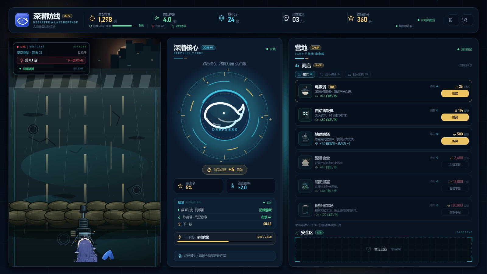

# 深潜防线 / Click_DeepSeek

> 2077 · 人类最后的补给站  
> 一款轻量级点击防御小游戏：点击深潜核心赚取白饭，购买建筑提升产出，守住铁盆号的防线。



## 当前版本：v0.2.0 · 交互首版

核心循环已经接上：

- **点击深潜核心**：增加白饭，带连击倍率、5% 暴击、点击脉冲和奖励数字；
- **购买建筑**：点击商店里的购买按钮，扣除白饭、增加持有数、提升产出/战斗力；
- **价格成长**：建筑价格随持有数按 1.15 倍上涨；
- **自动产出**：建筑每秒产出白饭，顶栏、核心目标和商店可购买状态实时刷新；
- **顶栏数据**：白饭存量、产出、战斗力、波次、积分、防线耐久、击杀等；
- **营地**：商店（建筑 / 战斗装备 / 战术道具）与安全区（暂为空地）。

> 截图是模拟 12 次点击并购买 1 次电饭煲后的状态：白饭 1,298、产出 4.0/秒、电饭煲持有 ×4。

## 当前可玩

1. 点击中央深潜核心赚白饭；
2. 在营地商店购买建筑；
3. 观察顶栏产出、商店价格和核心下一目标实时变化。

## 尚未接入

- 僵尸波次生成与沿街道推进；
- 鱼/机枪自动射击、击杀、防线受损与游戏结束；
- 暴击/连击以外的战斗加成；
- 暂停、设置、存档。

## 视觉与轻量化

- 街道（含做旧沙袋墙）、机枪、尾巴、核心与图标为原创或经裁切处理的素材。
- 角色只保留头部和尾部两块素材，不打包完整立绘。
- 无第三方插件、无外部字体文件、无音频资源；运行时只依赖 Godot 与 .NET。
- `images/`（完整参考图库）、`tools/`（本地引擎）不纳入版本库。

## 运行

环境：**Godot 4.7.2 .NET 版**、**.NET SDK 9+**。

1. 用 Godot .NET 版打开根目录的 `project.godot`。
2. 按 `F5` 运行。
3. 命令行示例：

```powershell
Godot_v4.7.2-stable_mono_win64_console.exe --path .
```

构建 C#：

```powershell
dotnet build ClickDeepSeek.csproj
```

## 目录

```text
project.godot              Godot 工程配置
ClickDeepSeek.csproj       C# 工程
scenes/Main.tscn           主场景（UI 由 C# 程序化搭建）
scripts/                   界面、状态与视觉代码
assets/art/                街道、沙袋、机枪、鱼头/尾巴等
assets/icons/              状态图标与建筑图标
assets/ui/                 品牌图标
docs/ui_v0.2.0.jpg         v0.2.0 界面截图
example.md                 防线布局草图
```

## 版本记录

- **v0.1-ui**：三栏主界面、顶栏数据、核心点击区、横向战场；C# / Godot 工程搭建完成。
- **v0.1.1-visual**：左侧战场改为纵向结构。
- **v0.1.2-street**：背景改为通向废弃城市的街道。
- **v0.1.3-road**：道路铺满战场；第三人称上帝视角。
- **v0.1.4-sandbag**：沙袋防线与机枪架设方案（已按反馈移除）。
- **v0.1.5-clean**：清空沙袋、机枪和角色。
- **v0.1.6-sandbag-line**：独立沙袋线（已按反馈移除）。
- **v0.1.7-background**：沙袋融入街道背景。
- **v0.1.8-sandbag-wall**：按参考图重画两层沙袋墙。
- **v0.1.9-aged-sandbags**：沙袋压暗做旧。
- **v0.1.10-partial**：机枪与鱼的局部露出。
- **v0.1.11-layout**：按 example.md 对齐防线布局。
- **v0.1.12-gun**：机枪缩小，枪口落在沙袋上。
- **v0.1.13-center-basin**：鱼居中挡枪托；钢盔换铁盆。
- **v0.1.14-opaque-basin**：铁盆不透明并压暗。
- **v0.1.15-no-basin**：移除铁盆。
- **v0.1.16-topbar**：防线下移，底部 HUD 数据并入顶栏。
- **v0.1.17-camp**：补给站改为营地，新增商店分类与安全区。
- **v0.2.0-interactive**：点击核心、购买建筑、价格成长、自动产出与实时数据刷新。
