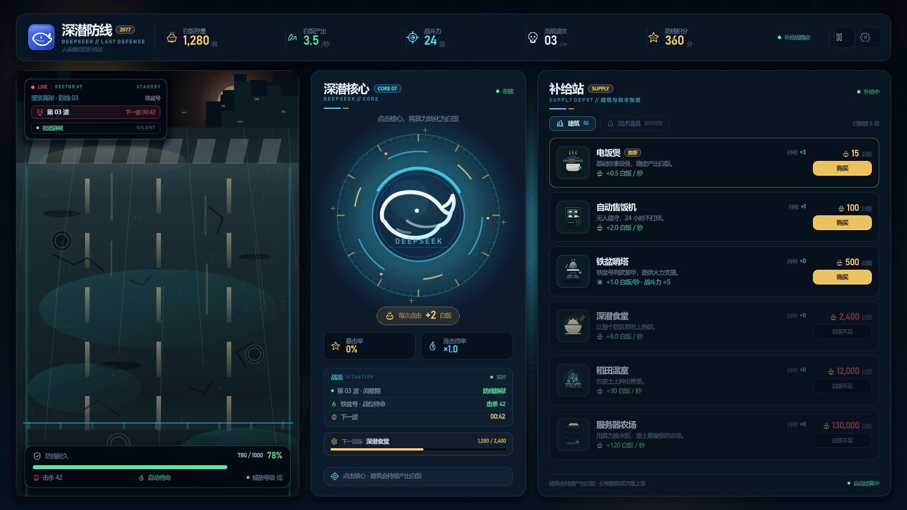

# 深潜防线 / Click_DeepSeek

> 2077 · 人类最后的补给站  
> 一款轻量级点击防御小游戏：点击深潜核心赚取白饭，购买建筑提升产出，守住铁盆号的防线。



## 当前版本：v0.1.5 · 清空防线元素

按最新反馈，先移除了左侧战场的沙袋、机枪和角色立绘，只保留已经确认的街道与废弃城市背景，避免继续猜构图。

- **左侧战场**：整条纵向街道铺满画面，顶部是废弃城市与斑马线；底部暂时只有道路和 HUD，没有沙袋、机枪或角色。
- **顶栏**：白饭存量、白饭产出、战斗力、当前波次、防线积分、暂停/设置入口。
- **中央核心**：深潜核心大按钮、每次点击收益、暴击/连击占位、战况与下一目标。
- **右侧补给站**：6 座建筑，费用、持有数、产出/战斗加成、可购买/白饭不足状态；战术道具页为锁定占位。

> 当前仍是“第 03 波间歇期”：街道静默、没有怪物。界面中的 1,280 白饭、3.5/秒等为**演示数据**。

## 接下来需要确定

1. 沙袋的**形态与位置**：底部一条矮沙袋？两侧堆叠留射击口？还是第一人称前景？
2. 机枪的**露出程度**：只露枪管、枪身+护盾，还是完整机枪？
3. 鱼在防线后的**可见范围**：只露后脑勺、后脑勺+肩，还是半身？
4. 视角是否保持现在的上帝俯视，还是稍微压低成越肩视角？

在确定这些之前，我不会再自行添加防线元素。

## 视觉与轻量化

- 街道、核心与图标为原创 SVG。
- 无第三方插件、无外部字体文件、无音频资源；运行时只依赖 Godot 与 .NET。
- `images/`（完整参考图库）、`tools/`（本地引擎）不纳入版本库。
- 当前移除的角色、沙袋、机枪素材保留在本地 `preview/` 中，不进入版本库。

## 运行

环境：**Godot 4.7.2 .NET 版**、**.NET SDK 9+**。

1. 用 Godot .NET 版打开根目录的 `project.godot`。
2. 按 `F5` 运行。
3. 命令行示例：

```powershell
Godot_v4.7.2-stable_mono_win64_console.exe --path .
```

构建 C#：

```powershell
dotnet build ClickDeepSeek.csproj
```

## 目录

```text
project.godot              Godot 工程配置
ClickDeepSeek.csproj       C# 工程
scenes/Main.tscn           主场景（UI 由 C# 程序化搭建）
scripts/                   界面与视觉代码
assets/art/                街道与核心等 SVG
assets/icons/              状态图标与建筑图标
assets/ui/                 品牌图标
docs/ui_v0.1.5.jpg         v0.1.5 界面截图
```

## 下一版计划（防线方案确认后）

- 按确认的构图重做沙袋、机枪和角色露出。
- 点击深潜核心获取白饭，加入点击反馈、连击与暴击。
- 建筑购买、价格增长、自动产出与战斗力结算。
- 怪物沿街道向下推进、鱼自动打怪、防线耐久与游戏结束。

## 版本记录

- **v0.1-ui**：三栏主界面、顶栏数据、核心点击区、横向战场、补给站建筑列表；C# / Godot 工程搭建完成。
- **v0.1.1-visual**：左侧战场改为纵向结构；尝试角色立绘 + 战术投影方案。
- **v0.1.2-street**：角色改为全身战斗形象；背景改为通向废弃城市的街道。
- **v0.1.3-road**：道路铺满战场；角色居中站在机枪后；第三人称上帝视角。
- **v0.1.4-sandbag**：沙袋防线与机枪架设方案（已按反馈移除）。
- **v0.1.5-clean**：清空沙袋、机枪和角色立绘，只保留街道与废弃城市，等待新的防线构图。
