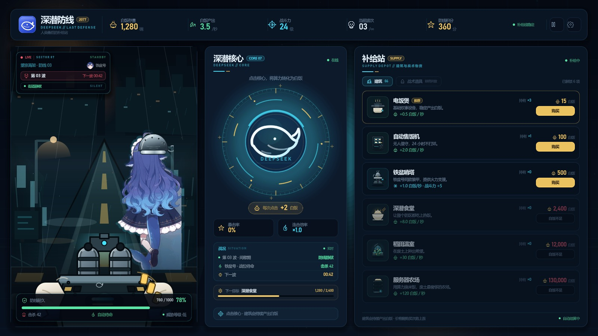

# 深潜防线 / Click_DeepSeek

> 2077 · 人类最后的补给站  
> 一款轻量级点击防御小游戏：点击深潜核心赚取白饭，购买建筑提升产出，守住铁盆号的防线。



## 当前版本：v0.1.2 · 街道备战场景

这一版仍然是**纯 UI**，交互逻辑尚未接入。

- **顶栏**：白饭存量、白饭产出、战斗力、当前波次、防线积分、暂停/设置入口。
- **左侧战场（重做）**：纵向街道，屏幕顶端是废弃城市天际线；角色以全身体从镜头后方站在自动机枪塔后，街道上暂时没有僵尸。
- **角色**：从 `images/` 中的 DeepSeek 鲸鱼娘动画帧提取，补绘铁盆，裁成约 45 KB 的透明 WebP；顶栏保留一个约 3 KB 的小头像。
- **中央核心**：深潜核心大按钮、每次点击收益、暴击/连击占位、战况与下一目标。
- **右侧补给站**：6 座建筑，费用、持有数、产出/战斗加成、可购买/白饭不足状态；战术道具页为锁定占位。

> 当前处于“第 03 波间歇期”：街道静默、机枪待命，没有放置僵尸。界面中的 1,280 白饭、3.5/秒等仍为**演示数据**。

## 视觉与轻量化

- 街道、机枪、铁盆、核心与图标均为原创 SVG。
- 角色全身像来自用户提供的 `images/`，经抠图、补盆与压缩处理；没有打包整套表情包。
- 无第三方插件、无外部字体文件、无音频资源；运行时只依赖 Godot 与 .NET。
- `images/`（完整参考图库）、`tools/`（本地引擎）不纳入版本库。

## 运行

环境：**Godot 4.7.2 .NET 版**、**.NET SDK 9+**。

1. 用 Godot .NET 版打开根目录的 `project.godot`。
2. 按 `F5` 运行。
3. 命令行示例：

```powershell
Godot_v4.7.2-stable_mono_win64_console.exe --path .
```

构建 C#：

```powershell
dotnet build ClickDeepSeek.csproj
```

## 目录

```text
project.godot              Godot 工程配置
ClickDeepSeek.csproj       C# 工程
scenes/Main.tscn           主场景（UI 由 C# 程序化搭建）
scripts/                   界面与视觉代码
assets/art/                街道、机枪、角色、铁盆等
assets/icons/              状态图标与建筑图标
assets/ui/                 品牌图标
docs/ui_v0.1.2.jpg         v0.1.2 界面截图
```

## 下一版计划（UI 通过后）

- 点击深潜核心获取白饭，加入点击反馈、连击与暴击。
- 建筑购买、价格增长、自动产出与战斗力结算。
- 僵尸波次推进、自动射击、防线耐久与游戏结束。
- 暂停、设置、存档；根据试玩反馈调整数值与节奏。

## 版本记录

- **v0.1-ui**：三栏主界面、顶栏数据、核心点击区、横向战场、补给站建筑列表；C# / Godot 工程搭建完成。
- **v0.1.1-visual**：左侧战场改为顶部出怪、底部防线的纵向结构；尝试角色立绘 + 战术投影方案。
- **v0.1.2-street**：角色改为镜头后方的全身战斗形象；背景改为通向废弃城市的街道；移除僵尸，改为静默备战场景。
