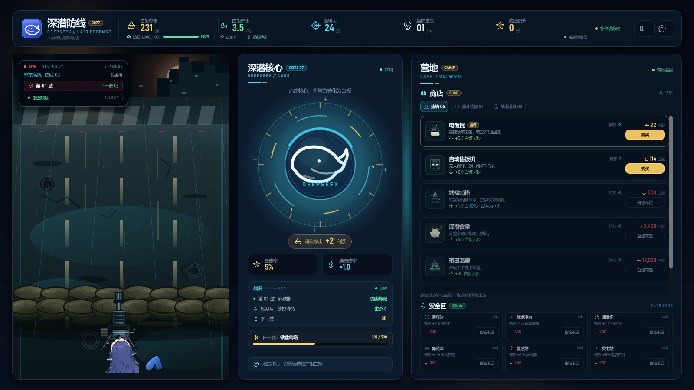
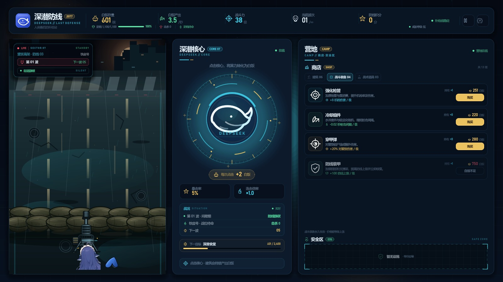
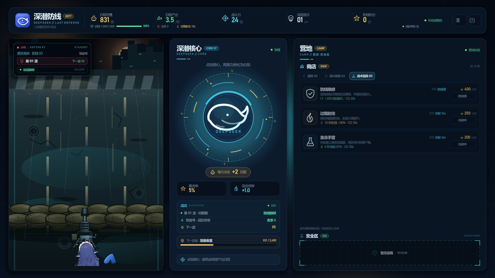

# 深潜防线 / Click_DeepSeek

> 2077 · 人类最后的补给站  
> 一款轻量级点击防御小游戏：点击深潜核心赚取白饭，购买建筑提升产出，守住铁盆号的防线。



## 当前版本：v0.2.6 · 扩展安全区设施

安全区扩展到 6 项设施，两行三列：

- **医疗站**：每级 +2 防线/秒，持续修复防线；
- **战术电台**：每级 -5% 战术道具冷却；
- **训练场**：每级 +1 点击白饭；
- **弹药库**：每级 +4% 机枪伤害；
- **雷达站**：每级 +1% 暴击率；
- **发电站**：每级 +8% 建筑产出。

所有设施都可直接在安全区升级，等级随存档保存；新设施效果已经接入战斗和产出计算。


## 商店与安全区

### 建筑（06）

电饭煲、自动售饭机、铁盆哨塔、深潜食堂、稻田温室、服务器农场。商店列表可滚动。

### 战斗装备（04）

强化枪管、冷却组件、穿甲弹、防线装甲。



### 战术道具（03）

防线维修、过载射击、急冻手雷。



## 当前可玩

1. 点击深潜核心赚白饭，连击叠倍率，5% 暴击；
2. 商店切换建筑/战斗装备/战术道具并购买/使用；
3. 安全区升级 6 项设施；
4. 自动机枪清剿尸潮，漏怪扣防线；
5. 暂停、设置、音效开关、自动保存/手动存档/读档；
6. 防线失守后重新部署。

## 尚未接入

- 背景音乐；
- 更多安全区设施槽位与设施外观；
- 更多僵尸外观、死亡动画；
- 长时间数值平衡。

## 视觉、音频与轻量化

- 街道（含做旧沙袋墙）、机枪、尾巴、核心与图标为原创或经裁切处理的素材。
- 僵尸由战斗场景实时绘制，不引入贴图序列。
- 音效由脚本程序化生成，不依赖外部音源。
- 无第三方插件、无外部字体文件；运行时只依赖 Godot 与 .NET。

## 运行

环境：**Godot 4.7.2 .NET 版**、**.NET SDK 9+**。

1. 用 Godot .NET 版打开根目录的 `project.godot`。
2. 按 `F5` 运行。
3. 命令行示例：

```powershell
Godot_v4.7.2-stable_mono_win64_console.exe --path .
```

构建 C#：

```powershell
dotnet build ClickDeepSeek.csproj
```

## 目录

```text
project.godot              Godot 工程配置
ClickDeepSeek.csproj       C# 工程
scenes/Main.tscn           主场景（UI 由 C# 程序化搭建）
scripts/                   界面、状态、战斗、商店、设施、音频、存档代码
assets/art/                街道、沙袋、机枪、鱼头/尾巴等
assets/audio/              程序化音效 WAV
assets/icons/              状态图标与建筑图标
assets/ui/                 品牌图标
docs/ui_v0.2.6.jpg         六项安全区设施
docs/ui_v0.2.5_settings.jpg 设置菜单
example.md                 防线布局草图
```

## 版本记录

- **v0.1-ui**：三栏主界面、顶栏数据、核心点击区、横向战场；C# / Godot 工程搭建完成。
- **v0.1.1-visual**：左侧战场改为纵向结构。
- **v0.1.2-street**：背景改为通向废弃城市的街道。
- **v0.1.3-road**：道路铺满战场；第三人称上帝视角。
- **v0.1.4-sandbag**：沙袋防线与机枪架设方案（已按反馈移除）。
- **v0.1.5-clean**：清空沙袋、机枪和角色。
- **v0.1.6-sandbag-line**：独立沙袋线（已按反馈移除）。
- **v0.1.7-background**：沙袋融入街道背景。
- **v0.1.8-sandbag-wall**：按参考图重画两层沙袋墙。
- **v0.1.9-aged-sandbags**：沙袋压暗做旧。
- **v0.1.10-partial**：机枪与鱼的局部露出。
- **v0.1.11-layout**：按 example.md 对齐防线布局。
- **v0.1.12-gun**：机枪缩小，枪口落在沙袋上。
- **v0.1.13-center-basin**：鱼居中挡枪托；钢盔换铁盆。
- **v0.1.14-opaque-basin**：铁盆不透明并压暗。
- **v0.1.15-no-basin**：移除铁盆。
- **v0.1.16-topbar**：防线下移，底部 HUD 数据并入顶栏。
- **v0.1.17-camp**：补给站改为营地，新增商店分类与安全区。
- **v0.2.0-interactive**：点击核心、购买建筑、价格成长、自动产出。
- **v0.2.1-combat**：僵尸波次、自动射击、防线受损与失守重开。
- **v0.2.2-save**：暂停、设置、自动保存/手动存档/读档。
- **v0.2.3-items**：战斗装备四项、战术道具三项与实际效果。
- **v0.2.4-facilities**：安全区加入医疗站、战术电台、训练场。
- **v0.2.5-audio**：点击/购买/射击/命中/漏怪/警报/道具/失守音效与音效开关。
- **v0.2.6-facilities-more**：安全区扩展到弹药库、雷达站、发电站共六项设施。
