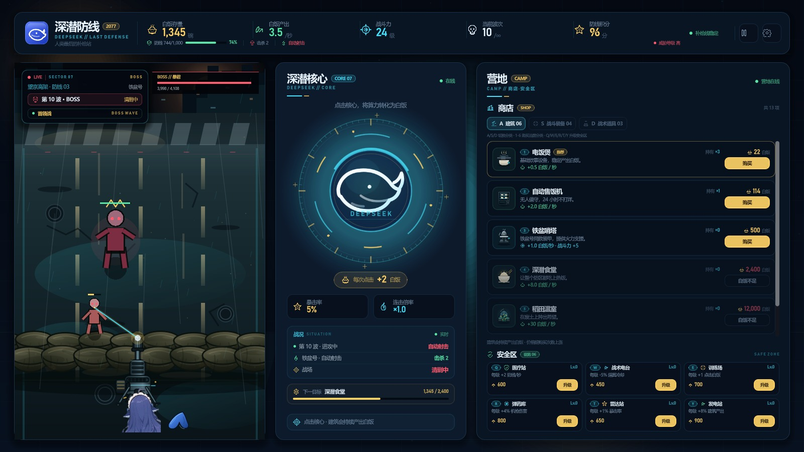
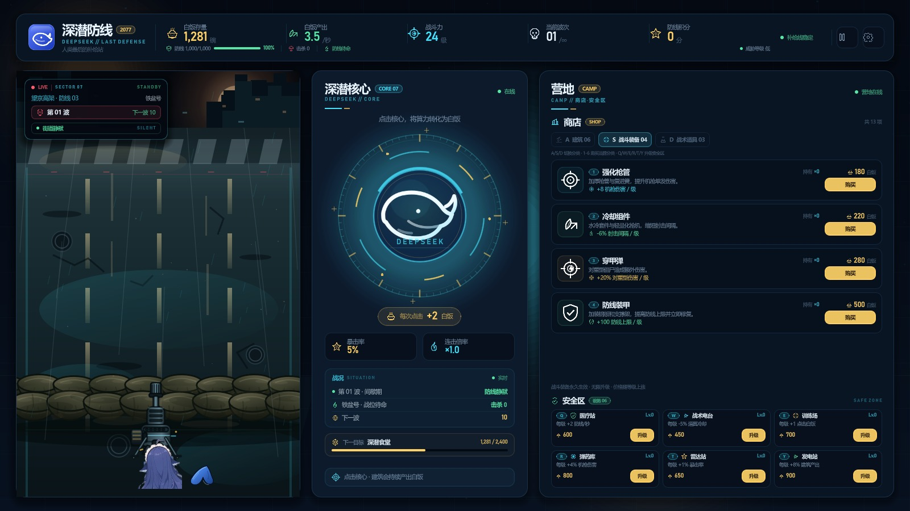

# 深潜防线 / Click_DeepSeek

> 2077 · 人类最后的补给站  
> 一款轻量级点击防御小游戏：点击深潜核心赚取白饭，购买建筑提升产出，守住铁盆号的防线。



## 当前版本：v0.3.0 · 分类快捷键 / Boss 战 / 难度陡增

### 购买、设施与分类快捷键

- **A / S / D**：切换商店分类（建筑 / 战斗装备 / 战术道具）；
- 商店当前分类物品：**1–6** 购买/使用；
  - 建筑：1–6 购买；
  - 战斗装备：1–4 购买；
  - 战术道具：1–3 使用；
- 安全区设施：**Q / W / E / R / T / Y** 依次升级医疗站、战术电台、训练场、弹药库、雷达站、发电站；
- 分类标签显示 A/S/D，卡片左上角显示对应物品键，分类下方有快捷键提示；
- 暂停/失守时快捷键不会触发。



### 每 10 波 Boss 战

- 第 **10 / 20 / 30 …** 波为 Boss 波；
- 首领“暴君”拥有独立的高额生命值、巨大体型、王冠标识和顶部 Boss 血条；
- Boss 会带少量护卫，击杀后获得高额积分和白饭；
- 战斗 HUD 会切换为 `BOSS` / `首领战` / `BOSS WAVE`；
- Boss 波结束后恢复正常波次。


### 难度曲线加陡

当前波次公式：

- 普通僵尸数量：`min(90, 6 + 2 × 波次 + 波次² / 30)`；
- 普通生命：`45 + 15 × 波次 + 0.7 × 波次²`；
- 移动速度：`24 + 2.4 × 波次`；
- 漏怪伤害：`50 + 7 × 波次 + 0.08 × 波次²`；
- 刷怪间隔更低，后期数量上限 90，但生命/速度继续成长；
- Boss 生命按普通生命与波次倍率额外放大，每 10 波一次。

同时提高了击杀与波次奖励，给无限装备升级留出成长空间。

### 无限武器升级

战斗装备取消了等级上限：

- 强化枪管、冷却组件、穿甲弹、防线装甲都可以无限升级；
- 价格继续按等级指数增长；
- 冷却组件每级约 -6% 射击间隔，递减式提升；
- 战斗装备卡片不再显示“已满级”。

## 商店与安全区

### 建筑（06）

电饭煲、自动售饭机、铁盆哨塔、深潜食堂、稻田温室、服务器农场。商店列表可滚动。

### 战斗装备（04，无限升级）

强化枪管、冷却组件、穿甲弹、防线装甲。

### 战术道具（03）

防线维修、过载射击、急冻手雷。

### 安全区（06）

医疗站、战术电台、训练场、弹药库、雷达站、发电站。

## 当前可玩

1. 点击深潜核心赚白饭，连击叠倍率，5% 暴击；
2. 商店切换建筑/战斗装备/战术道具并购买/使用；
3. 用 A/S/D 切换分类，1–6 购买当前分类，Q–Y 升级安全区；
4. 自动机枪清剿尸潮，每 10 波迎战 Boss“暴君”；
5. 暂停、设置、音量滑条、音效/音乐开关、自动保存/手动存档/读档；
6. 防线失守后重新部署。

## 尚未接入

- 更多安全区设施槽位与设施外观；
- 更多僵尸外观、死亡动画；
- 更多 Boss 种类与阶段机制。

## 视觉、音频与轻量化

- 街道（含做旧沙袋墙）、机枪、尾巴、核心与图标为原创或经裁切处理的素材。
- 僵尸由战斗场景实时绘制，不引入贴图序列。
- 音效与 BGM 均由脚本程序化生成；音频总量约 0.8 MB。
- 无第三方插件、无外部字体文件；运行时只依赖 Godot 与 .NET。

## 运行

环境：**Godot 4.7.2 .NET 版**、**.NET SDK 9+**。

1. 用 Godot .NET 版打开根目录的 `project.godot`。
2. 按 `F5` 运行。
3. 命令行示例：

```powershell
Godot_v4.7.2-stable_mono_win64_console.exe --path .
```

构建 C#：

```powershell
dotnet build ClickDeepSeek.csproj
```

## 发布（Windows 免安装包）

`build/` 就是可以直接打 zip 上传的目录：

```text
ClickDeepSeek.exe   Godot 4.7.2 引擎本体，保留 Godot 官方 Authenticode 签名
Game/               工程与素材，含预编译的 .godot/mono/temp/bin/Debug/ClickDeepSeek.dll
GodotSharp/         .NET 托管支持库
save/               存档目录（安装目录只读时自动回落到 %APPDATA%）
深潜防线.lnk         入口，等价于 ClickDeepSeek.exe --path Game
说明.txt            给下载者的运行说明
```

两条必须遵守的规矩：

1. **不要用 rcedit 改 exe 的图标或版本信息**，任何 PE 资源改动都会让 Godot 的官方签名失效，
   Windows 会重新把它当成"未知发布者"。要品牌化就等自建证书签名之后再做。
2. **每次发版都要刷新 Game 里的程序集**：

```powershell
dotnet build ClickDeepSeek.csproj
Copy-Item .godot/mono/temp/bin/Debug/ClickDeepSeek.dll `
          build/Game/.godot/mono/temp/bin/Debug/ClickDeepSeek.dll -Force
```

不要让下载者直接双击 `ClickDeepSeek.exe`（会进入引擎项目管理器），入口是快捷方式。

## 目录

```text
project.godot              Godot 工程配置
ClickDeepSeek.csproj       C# 工程
scenes/Main.tscn           主场景（UI 由 C# 程序化搭建）
scripts/                   界面、状态、战斗、商店、设施、音频、存档代码
assets/art/                街道、沙袋、机枪、鱼头/尾巴等
assets/audio/              程序化音效与 BGM
assets/icons/              状态图标与建筑图标
assets/ui/                 品牌图标
docs/ui_v0.3.0_boss.jpg    Boss 战
docs/ui_v0.3.0_categories.jpg 分类快捷键
example.md                 防线布局草图
```

## 版本记录

- **v0.1-ui**：三栏主界面、顶栏数据、核心点击区、横向战场；C# / Godot 工程搭建完成。
- **v0.1.1-visual**：左侧战场改为纵向结构。
- **v0.1.2-street**：背景改为通向废弃城市的街道。
- **v0.1.3-road**：道路铺满战场；第三人称上帝视角。
- **v0.1.4-sandbag**：沙袋防线与机枪架设方案（已按反馈移除）。
- **v0.1.5-clean**：清空沙袋、机枪和角色。
- **v0.1.6-sandbag-line**：独立沙袋线（已按反馈移除）。
- **v0.1.7-background**：沙袋融入街道背景。
- **v0.1.8-sandbag-wall**：按参考图重画两层沙袋墙。
- **v0.1.9-aged-sandbags**：沙袋压暗做旧。
- **v0.1.10-partial**：机枪与鱼的局部露出。
- **v0.1.11-layout**：按 example.md 对齐防线布局。
- **v0.1.12-gun**：机枪缩小，枪口落在沙袋上。
- **v0.1.13-center-basin**：鱼居中挡枪托；钢盔换铁盆。
- **v0.1.14-opaque-basin**：铁盆不透明并压暗。
- **v0.1.15-no-basin**：移除铁盆。
- **v0.1.16-topbar**：防线下移，底部 HUD 数据并入顶栏。
- **v0.1.17-camp**：补给站改为营地，新增商店分类与安全区。
- **v0.2.0-interactive**：点击核心、购买建筑、价格成长、自动产出。
- **v0.2.1-combat**：僵尸波次、自动射击、防线受损与失守重开。
- **v0.2.2-save**：暂停、设置、自动保存/手动存档/读档。
- **v0.2.3-items**：战斗装备四项、战术道具三项与实际效果。
- **v0.2.4-facilities**：安全区加入医疗站、战术电台、训练场。
- **v0.2.5-audio**：程序化音效与音效开关。
- **v0.2.6-facilities-more**：安全区扩展到六项设施。
- **v0.2.7-bgm**：16 秒无缝循环背景音乐与独立音乐开关。
- **v0.2.8-balance**：音效/音乐音量滑条，开局准备与波次数值平衡。
- **v0.2.9-shortcuts**：1–6 购买快捷键、Q–Y 设施快捷键、无限武器升级。
- **v0.3.0-boss**：A/S/D 分类快捷键、每 10 波 Boss 战“暴君”、加陡难度曲线。
