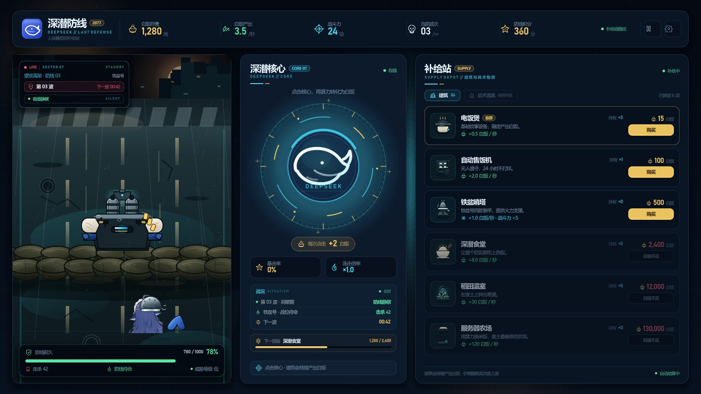

# 深潜防线 / Click_DeepSeek

> 2077 · 人类最后的补给站  
> 一款轻量级点击防御小游戏：点击深潜核心赚取白饭，购买建筑提升产出，守住铁盆号的防线。



## 当前版本：v0.1.11 · 按 example.md 对齐防线

读了 `example.md` 后，把之前放反的机枪/角色移到了正确位置：

- **顶部**：出怪口与废弃城市；
- **中部**：怪物经过的纵向街道；
- **底部横向沙袋线**：做旧沙袋墙，横向铺满，作为防线；
- **沙袋线下方**：机枪架在沙袋上，鱼在安全区里架枪；
- 玩家只看到鱼的后脑勺/铁盆、头发和一小段尾巴，不出现完整立绘；
- 当前没有怪物。

其余部分：

- **顶栏**：白饭存量、白饭产出、战斗力、当前波次、防线积分、暂停/设置入口。
- **中央核心**：深潜核心大按钮、每次点击收益、暴击/连击占位、战况与下一目标。
- **右侧补给站**：6 座建筑，费用、持有数、产出/战斗加成、可购买/白饭不足状态。

> 当前是“第 03 波间歇期”：街道静默、防线待命。界面数据为**演示数据**。

## 下一步

- 确认沙袋线高度、机枪架设位置、鱼头和尾巴的露出比例；
- 确认后接点击、自动产出、怪物沿街道推进与自动射击。

## 视觉与轻量化

- 街道（含做旧沙袋墙）、机枪、尾巴、铁盆、核心与图标为原创或经裁切处理的素材。
- 角色只保留头部和尾部两块素材，不打包完整立绘。
- 无第三方插件、无外部字体文件、无音频资源；运行时只依赖 Godot 与 .NET。
- `images/`（完整参考图库）、`tools/`（本地引擎）不纳入版本库。

## 运行

环境：**Godot 4.7.2 .NET 版**、**.NET SDK 9+**。

1. 用 Godot .NET 版打开根目录的 `project.godot`。
2. 按 `F5` 运行。
3. 命令行示例：

```powershell
Godot_v4.7.2-stable_mono_win64_console.exe --path .
```

构建 C#：

```powershell
dotnet build ClickDeepSeek.csproj
```

## 目录

```text
project.godot              Godot 工程配置
ClickDeepSeek.csproj       C# 工程
scenes/Main.tscn           主场景（UI 由 C# 程序化搭建）
scripts/                   界面与视觉代码
assets/art/                街道、沙袋、机枪、鱼头/尾巴等
assets/icons/              状态图标与建筑图标
assets/ui/                 品牌图标
docs/ui_v0.1.11.jpg        v0.1.11 界面截图
example.md                 防线布局草图
```

## 版本记录

- **v0.1-ui**：三栏主界面、顶栏数据、核心点击区、横向战场；C# / Godot 工程搭建完成。
- **v0.1.1-visual**：左侧战场改为纵向结构。
- **v0.1.2-street**：背景改为通向废弃城市的街道。
- **v0.1.3-road**：道路铺满战场；第三人称上帝视角。
- **v0.1.4-sandbag**：沙袋防线与机枪架设方案（已按反馈移除）。
- **v0.1.5-clean**：清空沙袋、机枪和角色。
- **v0.1.6-sandbag-line**：独立沙袋线（已按反馈移除）。
- **v0.1.7-background**：沙袋融入街道背景。
- **v0.1.8-sandbag-wall**：按参考图重画两层沙袋墙。
- **v0.1.9-aged-sandbags**：沙袋压暗做旧。
- **v0.1.10-partial**：机枪与鱼的局部露出（位置待修正）。
- **v0.1.11-layout**：按 example.md 把沙袋线、机枪、角色安全区和出怪方向对齐。
