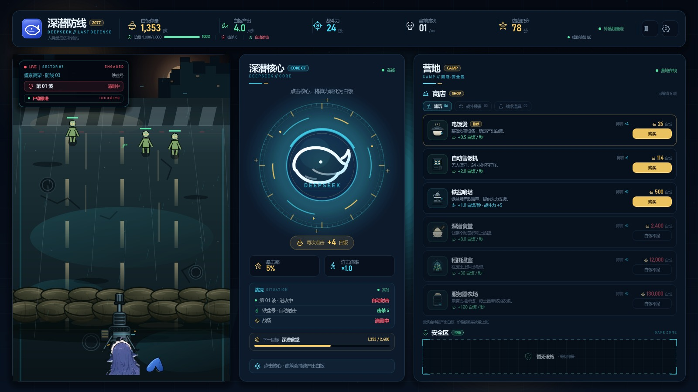
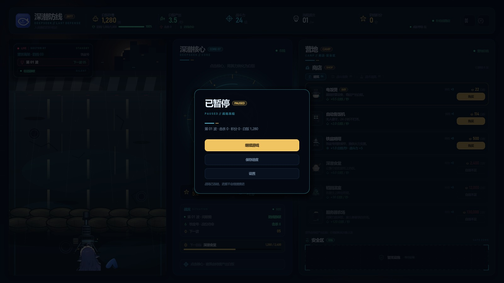
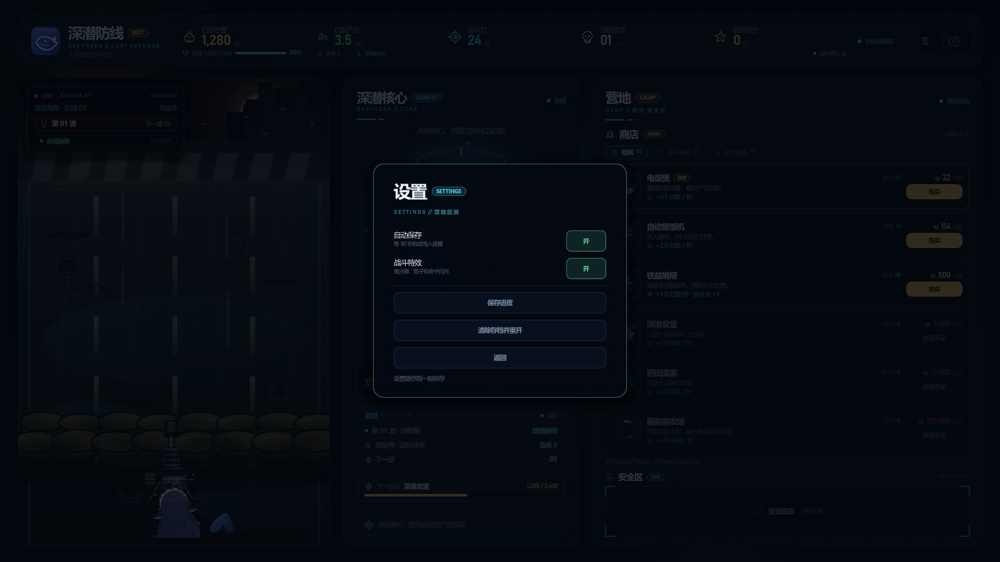

# 深潜防线 / Click_DeepSeek

> 2077 · 人类最后的补给站  
> 一款轻量级点击防御小游戏：点击深潜核心赚取白饭，购买建筑提升产出，守住铁盆号的防线。



## 当前版本：v0.2.2 · 暂停、设置与存档

系统功能补齐：

- **暂停**：顶栏暂停按钮打开全屏菜单，冻结白饭产出、波次计时、僵尸推进和自动射击；可继续、保存、进入设置，`Esc` 也可返回；
- **设置**：
  - 自动保存：每 30 秒自动写入进度；
  - 战斗特效：关闭后减少曳光弹、粒子和命中闪光；
  - 保存进度；
  - 清除存档并重开（二次确认）；
- **存档**：
  - 保存白饭、建筑持有数、防线耐久、击杀、积分、当前波次和设置；
  - 启动时自动读取；
  - 战斗中存档，读档后从当前波的 5 秒间歇重新开始（不保存僵尸实时位置）；
  - 防线失守时不允许保存；
  - 优先写入 `user://click_deepseek_save.json`，不可写时回退到项目根目录 `savegame.json`；本地存档已加入 `.gitignore`。





## 当前可玩

1. 点击深潜核心赚白饭，连击叠倍率，5% 暴击；
2. 在营地商店购买建筑，提升产出和战斗力；
3. 自动机枪清剿尸潮，漏怪扣防线，失守后可重新部署；
4. 暂停、保存、读档、设置自动保存与战斗特效。

## 尚未接入

- 战斗装备、战术道具的实际物品与效果；
- 音效与音乐；
- 更多僵尸外观、死亡动画；
- 长时间数值平衡。

## 视觉与轻量化

- 街道（含做旧沙袋墙）、机枪、尾巴、核心与图标为原创或经裁切处理的素材。
- 僵尸由战斗场景实时绘制，不引入贴图序列。
- 无第三方插件、无外部字体文件、无音频资源；运行时只依赖 Godot 与 .NET。

## 运行

环境：**Godot 4.7.2 .NET 版**、**.NET SDK 9+**。

1. 用 Godot .NET 版打开根目录的 `project.godot`。
2. 按 `F5` 运行。
3. 命令行示例：

```powershell
Godot_v4.7.2-stable_mono_win64_console.exe --path .
```

构建 C#：

```powershell
dotnet build ClickDeepSeek.csproj
```

## 目录

```text
project.godot              Godot 工程配置
ClickDeepSeek.csproj       C# 工程
scenes/Main.tscn           主场景（UI 由 C# 程序化搭建）
scripts/                   界面、状态、战斗、暂停/设置/存档代码
assets/art/                街道、沙袋、机枪、鱼头/尾巴等
assets/icons/              状态图标与建筑图标
assets/ui/                 品牌图标
docs/ui_v0.2.2.jpg         v0.2.2 界面截图
docs/ui_v0.2.2_pause.jpg   暂停菜单
example.md                 防线布局草图
```

## 版本记录

- **v0.1-ui**：三栏主界面、顶栏数据、核心点击区、横向战场；C# / Godot 工程搭建完成。
- **v0.1.1-visual**：左侧战场改为纵向结构。
- **v0.1.2-street**：背景改为通向废弃城市的街道。
- **v0.1.3-road**：道路铺满战场；第三人称上帝视角。
- **v0.1.4-sandbag**：沙袋防线与机枪架设方案（已按反馈移除）。
- **v0.1.5-clean**：清空沙袋、机枪和角色。
- **v0.1.6-sandbag-line**：独立沙袋线（已按反馈移除）。
- **v0.1.7-background**：沙袋融入街道背景。
- **v0.1.8-sandbag-wall**：按参考图重画两层沙袋墙。
- **v0.1.9-aged-sandbags**：沙袋压暗做旧。
- **v0.1.10-partial**：机枪与鱼的局部露出。
- **v0.1.11-layout**：按 example.md 对齐防线布局。
- **v0.1.12-gun**：机枪缩小，枪口落在沙袋上。
- **v0.1.13-center-basin**：鱼居中挡枪托；钢盔换铁盆。
- **v0.1.14-opaque-basin**：铁盆不透明并压暗。
- **v0.1.15-no-basin**：移除铁盆。
- **v0.1.16-topbar**：防线下移，底部 HUD 数据并入顶栏。
- **v0.1.17-camp**：补给站改为营地，新增商店分类与安全区。
- **v0.2.0-interactive**：点击核心、购买建筑、价格成长、自动产出与实时数据刷新。
- **v0.2.1-combat**：僵尸波次、自动射击、击杀/积分、防线受损与失守重开。
- **v0.2.2-save**：暂停菜单、设置项、自动保存/手动存档/读档。
